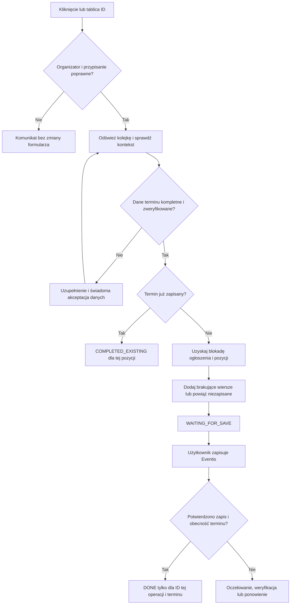

# Raport naprawy kolejki Asystenta Eventis

Data: 23.10.2026. Status: **PASS — walidacja lokalna**.

Nie wykonywano commita, push ani połączeń z produkcyjnymi serwisami. Ręczna weryfikacja zalogowanej sesji Eventis pozostaje do wykonania.

## 1. Audyt i przyczyny

Przed zmianami wykonano `git status --short --branch`, `git branch --show-current`, `git log -5 --oneline` oraz `git diff --check`. Gałąź: `main`, bez lokalnych zmian. Ostatnie commity: `cea14ba`, `c9a29cb`, `734bfca`, `160491a`, `70afbcb`.

Przycisk miał bezpośredni handler `addEventListener("click", wprowadzTerminyZKolejki)`. Przeglądarka przekazywała `MouseEvent` jako `identyfikatoryDozwolone`; `new Set(identyfikatoryDozwolone)` powodowało `TypeError`, ponieważ zdarzenie nie jest iterowalne. Osobny handler wywołuje teraz funkcję bez argumentów; wywołania automatyczne nadal przekazują tablicę ID. Funkcja sprawdza typ argumentu i ustawia blokadę przed pierwszym `await`.

Druga usterka: `confirmPendingSaved()` po rozliczeniu operacji wywoływało `oznaczElementySzkoleniaJakoZakonczone()`. Funkcja oznaczała również inne pozycje tego tytułu jako `DONE`. Usunięto tę zbiorczą ścieżkę i nieużywaną funkcję. Zapis bez operacji nie rozlicza kolejki.

Brak ogłoszenia Eventis był niebieski, ponieważ `.esync-kolejka-brak-dopasowania` miała niebieskie tło i diodę. Logika kafelków dodatkowo używała tej klasy dla problemów źródła i niejednoznaczności. Rozdzielono te przypadki.

Wykryto również nadpisywanie wcześniejszych terminów przy kolejnym imporcie w `event/add`: wybierano pierwsze wiersze zamiast pustych i nowo dodanych. Wcześniejsze wypełnione wiersze są teraz zachowywane.

## 2. Zmienione pliki

| Plik | Zmiana |
| --- | --- |
| `content/eventis.js` | Obsługa kliknięcia, walidacja kontekstu, blokady, indywidualne rozliczanie, zestawienie w formularzu, uzupełnianie danych, odtworzenie sesji, prezentacja niezapisanego formularza. |
| `content/eventis.css` | Kolory statusów, lokalne stany przycisku kolejki i sekcja formularza. |
| `content/lista-eventis.js` | Niezależne znaczniki źródła i ogłoszenia, kontynuowanie sprawdzania Eventis po problemie źródła, weryfikacja ręcznego URL, otwieranie bez wymogu źródła. |
| `shared/kolejka-eventis.js` | Wspólne opisy statusów, przypisania obejmujące wszystkie stany, walidacja zaakceptowanych danych, usunięcie zbiorczego kończenia szkolenia. |
| `shared/operacje-eventis.js` | Blokowanie równoległych operacji na tym samym ogłoszeniu, również ze starym kluczem operacji kolejki. |
| `tests/kolejka-formularz-dom.test.js` | Nowe testy rzeczywistego DOM, kliknięć, formularzy, kolorów i niezależności wyszukiwania. |
| `tests/kolejka-eventis.test.js` | Indywidualne rozliczanie oraz walidacja danych bez źródła i zakresów czterodniowych. |
| `tests/operacje-eventis.test.js` | Konflikt dwóch kart tego samego ogłoszenia przy różnych terminach. |
| `tests/potwierdzenia-kolejki.test.js` | Rozliczanie tylko pozycji operacji, odtwarzanie sesji dodawania po przejściu do edycji. |
| `tests/pola-rich-text.test.js` | Regresja uzupełniania opisów i zachowania informacji o wypełnionych terminach po błędzie edytora. |
| `tests/reczny-link-semper.test.js` | Weryfikacja źródła i jego odrębnego statusu bez przerywania całego procesu. |
| `RAPORT_NAPRAWY_KOLEJKI.md` | Ten raport. |

Przeanalizowano również `shared/terminy.js`, `shared/lista-eventis.js`, mechanizm otwierania i mapowań, potwierdzanie zapisu oraz host panelu bocznego. Nie zmieniano schematu trwałych statusów ani zależności projektu.

## 3. Przebieg kolejki

Kliknięcie importu nie wysyła formularza Eventis. Automatyczne oznaczanie zapisu wymaga wyniku obserwacji aktualnej próby zapisu; sama obecność pól lub stary komunikat sukcesu nie wystarczają. Ręczne potwierdzenie zapisu pozostaje świadomą czynnością użytkownika.

## 4. Stare i nowe znaczenie statusów

| Warstwa / dotychczasowy stan | Nowa interpretacja |
| --- | --- |
| Dopasowanie Eventis: `AUTO_MATCH`, `KNOWN_MAPPING`, zaakceptowany `MANUAL_MATCH` | Prezentacyjne `FOUND`. |
| Plan otwierania: `READY` | Gotowość otwarcia karty, bez potwierdzenia zapisu terminów. |
| Eventis: `NOT_FOUND` | Czerwony brak wyniku ogłoszenia; ponów, wskaż istniejące lub świadomie wybierz nowe. |
| Eventis: `CREATE_NEW` | Czerwona informacja o decyzji użytkownika, bez automatycznego tworzenia. |
| Źródło: zakończone `SEARCH_EMPTY` | `NOT_FOUND` wyłącznie dla SEMPER/IIST. |
| Wyszukiwanie niejednoznaczne | `AMBIGUOUS`, pomarańczowy wybór właściwego wyniku. |
| Wyszukiwanie: HTTP, timeout, błąd odczytu | `ERROR`, szary problem techniczny; nie `NOT_FOUND`. |
| Wyszukiwanie nierozpoczęte / trwające | `UNKNOWN` / `SEARCHING`, szary. |
| Kolejka: `PENDING` | Oczekuje; gotowość i pochodzenie potwierdzenia są pokazywane osobno. |
| Kolejka: `WAITING_FOR_SAVE` | Formularz zawiera dane, zapis niepotwierdzony; pomarańczowy. |
| Kolejka: `DONE` | Potwierdzony zapis konkretnej pozycji operacji; zielony. |
| Kolejka: `COMPLETED_EXISTING` | Termin już istnieje w zapisanych danych; zielony, bez zamiany na `DONE` po zapisie innego terminu. |
| Kolejka: `ERROR`, `NEEDS_ATTENTION` | Problem operacji lub wymagane sprawdzenie; pomarańczowy, z możliwością ponowienia. |
| Kolejka: `SKIPPED` | Pominięty, szary, nadal widoczny w zestawieniu formularza. |
| Rekord kolejki: `CONFIRMED` | Potwierdzenie z kolejki; nie nadpisuje potwierdzenia źródłowego. |
| Rekord kolejki: `DECONFIRMED` | Nie promuje terminu do importu; konflikt z potwierdzeniem blokuje tę pozycję. |

## 5. Mapa kolorów

| Kolor | Główny / tło | Znaczenie |
| --- | --- | --- |
| Zielony | `#16a34a` / `#ecfdf3` | Poprawne rozpoznanie, istniejący termin lub potwierdzony zapis. |
| Fioletowy | `#9333ea`, hover `#7e22ce` / `#faf5ff` | `POTW. Z KOLEJKI`, bez utożsamiania z potwierdzeniem SEMPER/IIST. |
| Niebieski | `#2563eb`, tekst `#1e40af` / `#eff6ff` | Nie znaleziono szkolenia źródłowego albo konkretnego terminu na znalezionej stronie; tekst wskazuje różnicę. |
| Czerwony | `#dc2626`, tekst `#991b1b` / `#fef2f2` | Brak wyniku ogłoszenia Eventis lub świadoma decyzja utworzenia nowego. |
| Pomarańczowy | `#d97706` / `#fff7ed` | Niejednoznaczność, brakujące dane, konflikt lub oczekiwanie na zapis. |
| Szary | Odcienie neutralne | Nieustalony wynik, wyszukiwanie i problemy techniczne. |

Przycisk kolejki jest fioletowy, jeśli choć jeden gotowy termin ma wyłącznie potwierdzenie kolejki. Jest zielony przy potwierdzeniu wszystkich gotowych terminów przez źródło. Bez gotowych terminów jest nieaktywny; ma lokalne style hover, focus-visible, disabled i loading. Pozostałych zielonych przycisków nie zmieniano globalnie.

## 6. Niezależność SEMPER/IIST i Eventis

Stan źródła jest przechowywany lokalnie w stanie widoku jako `statusZrodla`, a wynik ogłoszenia jest obliczany niezależnie z resolvera i decyzji użytkownika. Wspólne funkcje prezentacyjne zwracają osobne znaczniki `zrodlo` i `ogloszenie`. Nie dodano trwałego schematu statusów.

Brak źródła SEMPER nie przerywa odczytu Eventis. Oba problemy mogą być widoczne jednocześnie. Niejednoznaczność źródła i techniczny błąd pobierania nie są przedstawiane jako brak ogłoszenia. Brak pojedynczego terminu nie zmienia statusu znalezionego ogłoszenia na `NOT_FOUND`.

Panel boczny otrzymuje istniejącym mechanizmem ten sam DOM i wspólne CSS co panel pływający. Szczegóły i podsumowania korzystają z tych samych opisów statusów.

## 7. Ręczne wskazanie ogłoszenia

Zachowano akcję, nazwaną „Wskaż istniejące ogłoszenie”. Przed zapamiętaniem adres jest pobierany z bieżącymi uprawnieniami użytkownika. Sprawdzane są: bezpieczny URL, zgodność ID po przekierowaniu, obecność formularza, organizator z pola Firma, rzeczywisty tytuł i wariant lokalizacyjny. Dopiero poprawny wynik jest zapisywany jako ręczne mapowanie. Nie zmieniano zabezpieczeń podobnych tytułów i długości szkolenia.

„Wyszukaj ponownie” oraz „Utwórz nowe ogłoszenie” pozostają odrębnymi działaniami. Brak wyników sam nie ustawia `CREATE_NEW`.

## 8. Zestawienie w formularzu

Na dodawaniu i edycji znajduje się sekcja „📥 TERMINY Z KOLEJKI (N)” nad nagłówkiem terminów Eventis. Pokazuje daty początku i końca, lokalizację, liczbę uczestników, źródło potwierdzenia, obecność terminu i stan zapisu. Rozróżnia zapisane terminy od wierszy obecnych wyłącznie w formularzu.

Widoczne są wszystkie siedem stanów kolejki, również zakończone i pominięte. Przypisanie wykorzystuje zweryfikowaną sesję, pamięć mapowania lub ścisłe dopasowanie organizatora i tytułu. Nieposiadająca źródła kolejka pozostaje widoczna.

Dla brakujących danych dostępne jest uzupełnienie dat/lokalizacji oraz ceny netto i jawna akceptacja użycia danych kolejki. Istniejące daty i lokalizacja są chronione przed przypadkową zmianą tożsamości terminu. Akceptacja nie ustawia potwierdzenia SEMPER/IIST. Pomocnicze pola nie są wymaganymi polami Eventis i nie są wysyłane jako jego dane.

Sesja `event/add` nie wymaga liczbowego ID. Po przejściu do `event/edit` jest odtwarzana w tej samej karcie z kontekstu rzeczywistej próby zapisu, a przypisanie otrzymuje docelowe ID. Kolejne odświeżenie zachowuje to powiązanie. Różne karty nie przejmują nawzajem swoich operacji; dwie operacje tego samego ogłoszenia są blokowane.

## 9. Wyniki testów

| Kontrola | Wynik |
| --- | --- |
| `npm run check` | PASS. |
| `npm test` | PASS: **330/330**, błędy 0, pominięte 0, anulowane 0. |
| Testy przeglądarkowe projektu | PASS, w ramach `npm test`, Playwright i lokalny Edge. |
| `git diff --check` | PASS. |
| `git status --short` | Tylko pliki tego zadania; bez commita i push. |

Edge nie uruchamiał się w piaskownicy. Testy przeglądarkowe wykonano skutecznie poza nią. Nowe testy DOM blokują połączenia sieciowe i używają lokalnych danych oraz atrap transportu.

Testy obejmują rzeczywiste kliknięcie i podwójne kliknięcie, tablice ID, brak duplikatów, kolejne importy `event/add`, zapis tylko A przy oczekujących B/C, stary komunikat sukcesu, ponowienie, wszystkie stany listy, kolory i stany przycisku, kombinacje źródła i ogłoszenia dla SEMPER/IIST, HTTP, ręczny URL, akceptację ceny bez źródła, DECONFIRMED, inne tytuły i organizatorów, przejście add → edit oraz wielodniowe zakresy. Istniejąca regresja obejmuje także opisy, mapowania, otwieranie kart i panel boczny.

## 10. Checklista ręczna w przeglądarce

Poniższe punkty są **do wykonania na zalogowanym Eventis**; nie są deklaracją wykonania testów produkcyjnych.

- [ ] Przeładuj rozszerzenie i stronę Eventis; sprawdź panel pływający oraz boczny.
- [ ] Kliknij import kolejki raz i dwukrotnie; sprawdź brak duplikatów i brak błędów konsoli.
- [ ] Sprawdź zielony przycisk dla źródłowo potwierdzonych terminów i fioletowy przy potwierdzeniu wyłącznie kolejką.
- [ ] Sprawdź brak SEMPER przy znalezionym Eventis oraz analogiczny przypadek IIST; otwórz ogłoszenie i uzupełnij termin po weryfikacji danych.
- [ ] Sprawdź brak Eventis przy znalezionym źródle oraz brak obu; oba znaczniki muszą pozostać widoczne.
- [ ] Ponów wyszukiwanie Eventis; wskaż prawidłowy URL ręcznie, a następnie sprawdź odrzucenie innego organizatora i niezgodnego tytułu.
- [ ] Sprawdź świadomy wybór nowego ogłoszenia; samo wyszukiwanie nie może go utworzyć.
- [ ] Wskaż źródło ręcznie, sprawdź niejednoznaczne wyniki i uzupełnienie brakującej ceny bez zgadywania wartości.
- [ ] Sprawdź sekcję kolejki w `event/add` i `event/edit`, wszystkie statusy, daty, lokalizacje i uczestników.
- [ ] Wprowadź tylko A z terminów A/B/C. Przed zapisem A ma oczekiwać; po potwierdzonym zapisie tylko A ma otrzymać `DONE`.
- [ ] Wywołaj błąd walidacji Eventis oraz brak komunikatu zapisu; żaden z tych przypadków nie może automatycznie kończyć kolejki.
- [ ] Ponów operację po błędzie; istniejące niezapisane wiersze nie mogą być dublowane ani uznane za zapisane.
- [ ] Wykonaj dwa kolejne importy podczas dodawania; pierwszy termin nie może zostać nadpisany.
- [ ] Zapisz nowe ogłoszenie, przejdź do edycji i odśwież; sprawdź przypisanie i historię zakończonych terminów.
- [ ] Otwórz różne ogłoszenia w dwóch kartach, a następnie to samo ogłoszenie w dwóch kartach; sprawdź niezależność i blokadę kolizji.
- [ ] Przełącz SEMPER/IIST oraz zmień tytuł; nie mogą pojawić się terminy innego organizatora lub podobnego szkolenia.
- [ ] Sprawdź DECONFIRMED, szkolenie czterodniowe, wariant miejscowości i ONLINE.
- [ ] Sprawdź import opisów, zapamiętane mapowania i automatyczne otwieranie kart.
- [ ] Odłącz sieć lub zasymuluj HTTP/timeout; komunikat techniczny ma być neutralny, bez stwierdzania nieistnienia szkolenia lub ogłoszenia.

## 11. Ograniczenia

- Nie sprawdzano aktualnego produkcyjnego HTML ani zapisu na zalogowanym koncie; polecenie zabraniało internetu. Testy nie zastępują końcowej kontroli rzeczywistego formularza i odpowiedzi serwera.
- Zachowano istniejący zakres wyszukiwania: preflight listy pobiera źródło SEMPER; wyszukiwanie i ręczne wskazywanie IIST pozostają w formularzu ogłoszenia. Nieprzeprowadzone wyszukiwanie źródła IIST jest oznaczone jako `UNKNOWN`, a nie fikcyjnie jako znalezione lub nieznalezione.
- Obsługiwane miasta i reguła czterodniowego szkolenia pozostają zgodne z dotychczasowym mechanizmem. Nieznanej lub niejednoznacznej lokalizacji nie wybiera się automatycznie.
- Bez rozpoznanego organizatora albo przy konflikcie tytułu, lokalizacji lub DECONFIRMED import jest blokowany dla niebezpiecznej pozycji.
- Jeśli formularz ładuje się bez rozpoznawalnego nagłówka sekcji terminów, zestawienie trafia na początek formularza i pozostaje widoczne nad jego polami.
- Powiązanie add → edit korzysta z istniejącego, dwuminutowego okna kontekstu próby zapisu; przy niejednoznaczności nie przypisuje automatycznie innego ogłoszenia.
- Ręczne potwierdzenie zapisu nadal opiera się na świadomej deklaracji użytkownika. Automatyczne potwierdzanie wymaga obserwacji próby zapisu i sprawdzenia odpowiednich terminów.

## 12. Ocena

**PASS dla lokalnej implementacji i regresji: 330/330 testów.** Checklista produkcyjna pozostaje niewykonana i jest wyraźnie oddzielona od wyników automatycznych.
